# PortalSync

Use one real Skylanders Portal of Power with **Cemu** (Wii U), **RPCS3** (PS3), **Dolphin** (Wii) and **shadPS4** (PS4) on Windows, and keep your game progress on your real figures. Play your real figures and figures from files on your PC at the same time.

PortalSync sits between your portal and the emulator. The game sees one portal, and that portal holds both the figures on your real portal and the figures you load from files (`.sky` files, the kind the emulators' own emulated portals use). Game saves go back onto the real figure, and every figure is backed up on your PC first. The real portal can stay plugged in the whole time.

Without PortalSync, an emulator uses either your real portal or its own emulated one. With PortalSync you get both at once, and a backup of every figure.

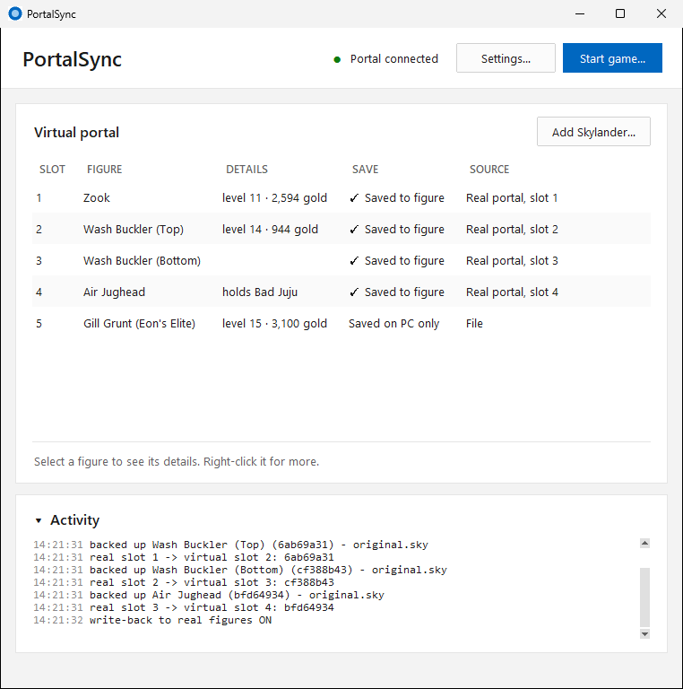

## Highlights

- **Real figures and file figures together:** play the figures on your real portal and `.sky` files from your PC at the same time, up to 16. Save **teams** of figures and load them in one click.
- **One portal for four emulators:** Cemu, RPCS3, Dolphin and shadPS4, with the real portal plugged in the whole time.
- **Your progress stays on your figures:** game saves are written back to the real figure and checked. Every figure has a **backup**, and a **SAVE** column shows whether each save has reached the figure. See [Your figures are safe](#your-figures-are-safe).
- **See inside your figures, and fix them:** level, gold, nickname, the villain inside a Trap Team trap, and each Skylander's progress history. **Repair** a damaged figure (the one the game rejects with "A toy on the portal has a problem"), or change gold, level, nickname and upgrades in the **figure editor**.
- **Comfort:** Trap Team sound on the Traptanium Portal's own speaker, portal lights that follow the game, **Start game…**, a Settings page, dark mode and updates in one click.

New here? [Getting started](#getting-started) takes three downloads and about ten minutes.

## Getting started

You need Windows 10 or 11 (64-bit), a Skylanders Portal of Power on USB, and Cemu, RPCS3, Dolphin or shadPS4 with a Skylanders game. Setup takes about ten minutes, and you only do it once. Every step can be undone: see [Remove everything](#remove-everything).

### 1. Install usbip-win2

usbip-win2 is a free, open-source driver that lets a program show a USB device to Windows. PortalSync uses it to show its virtual portal.

1. Download the installer (`USBip-….exe`) from [usbip-win2 release 0.9.8.1](https://github.com/vadimgrn/usbip-win2/releases/tag/v.0.9.8.1). That is the version PortalSync was tested with.
2. Run it with the default settings, so it installs to `C:\Program Files\USBip`. Allow the driver installation when Windows asks. Other USB devices can drop out for a moment while it installs.

To undo it later: uninstall **USBip** under Windows **Settings → Apps → Installed apps**.

### 2. Give the portal a libusb driver with Zadig

Windows treats the portal as a game controller (HID), so PortalSync can't read figures from it yet. Zadig is a free tool that swaps in a driver PortalSync can use (libusbK). This is a Windows setting for the portal on this PC. Nothing changes inside the portal, and it still works the same on a console.

1. Plug in the portal.
2. Download [Zadig](https://zadig.akeo.ie/) and start it. No install is needed.
3. In the menu, turn on **Options → List All Devices**.
4. In the drop-down list, choose **Spyro Porta**. That is the portal: it gives Windows this cut-off name. Check that the USB ID next to it reads **1430 0150**.
5. The box to the right of the green arrow shows the new driver. Click its small up and down arrows until it reads **libusbK**.
6. Click **Replace Driver** and wait until Zadig says it's done. This can take a minute.

> **Pick only the portal.** Zadig lists every USB device on your PC. If you replace the driver of another device, such as your keyboard or mouse, that device stops working until you undo it. The USB ID **1430 0150** is your check.

To undo it later: open **Device Manager** (right-click the Start button), open **libusbK USB Devices**, right-click **Spyro Porta**, choose **Uninstall device**, and tick "Attempt to remove the driver for this device". Then unplug the portal and plug it back in, and Windows uses its own driver again.

### 3. Download and start PortalSync

1. Download `PortalSync-….zip` from the [latest release](../../releases/latest) and unzip it to a folder of its own, for example `C:\PortalSync`. Keep everything from the zip together in that folder.
2. Double-click `PortalSync.exe`. Windows SmartScreen can warn, because PortalSync is a small free program that isn't signed: choose **More info → Run anyway**.
3. The **welcome window** opens. Pick light or dark, check that your emulators were found (or pick them with **Browse…**), and press **Start**. The **Setup** list at the bottom shows a green ✓ for everything from steps 1 and 2.
4. The status at the top right should say **Portal connected**. If it doesn't, see [If something doesn't work](#if-something-doesnt-work).

Some antivirus programs distrust PortalSync too. It has to hide the real portal from the emulator, and it does that with `portal_hide.dll`, a file it loads into the emulator while the emulator runs. Antivirus programs don't like that. If yours removes `PortalSync.exe` or `portal_hide.dll`, put the file back and add the PortalSync folder as an exception. Nothing is written to your emulator folders, and the source code is all in this repository.

### 4. Set up your emulator once

- **Cemu:** nothing to set. Keep Cemu's own emulated portal off: **Tools → Emulated USB Devices → Emulate Skylander Portal**. If you use the special Cemu *hybrid* build, also keep its *Hybrid* checkbox off.
- **Dolphin:** under **Config → Wii → Whitelisted USB Passthrough Devices**, click **Add…** and choose `1430:0150`. Keep Dolphin's own emulated Skylanders portal off.
- **shadPS4:** keep its USB device setting on **Real** (the default), so the game gets real USB devices and not shadPS4's own emulated portal. Start shadPS4 after PortalSync.
- **RPCS3:** nothing to set. Just make sure PortalSync is running before the game boots.

### 5. Play

1. In PortalSync, click **Start game…**, pick your game and click **Start**. Or start PortalSync first and then the game yourself.
2. Put figures on the real portal. They show up in the game within about a second, and your progress is saved back onto the figures.
3. Wait for **✓ Saved to figure** in the **SAVE** column before you lift a figure.
4. Click a figure in the list to see its details below the list, right-click it for more options, and use **Settings…** for everything else.

### Your figures are safe

Your figures hold years of progress, so PortalSync is careful with them.

- **Backed up first.** The first time you place a figure, PortalSync copies it to your PC before anything is written to it (`… - original.sky` in the `dumps` folder).
- **Every save is checked.** A game save is written to the figure and read back. The **SAVE** column says **✓ Saved to figure** when it's there. Lifted a figure too early? Place it again and PortalSync finishes the save. After a restart of PortalSync it asks first.
- **Progress from somewhere else is kept.** If you played a figure on a console in the meantime, PortalSync leaves the figure as it is. It keeps its own older copy as a backup and asks before it writes anything.
- **Restore, repair, reset and the editor back up first.** What the figure held is kept as its backup, so each of them can be undone.
- **You can try it without writing.** Untick **Write saves to real figures** in the welcome window or in Settings. PortalSync then never writes to a figure unless you tell it to, and your progress stays in the copies on your PC. Turn it on later to write that progress to the figures.

PortalSync always keeps `original`, and besides it one backup per figure by default, the newest. Older ones go to the Recycle Bin. Set **Backups per figure** in Settings (up to 10) to keep more. Once a day PortalSync also puts all your figure files in a zip, and it keeps the last 7.

### If something doesn't work

First try **Settings… → Check setup…**. It checks usbip-win2, the portal and its driver, the virtual portal and your emulators, and says what to do for anything that's missing. If PortalSync can't start at all, it opens that check by itself.

| What you see | What to do |
| --- | --- |
| The game says **"too many Portals"** | The game was started before PortalSync. Close the game, start PortalSync first (or use **Start game…**), then start the game again. Also check that `portal_hide.dll` is still next to `PortalSync.exe`: an antivirus program can remove it. |
| Status **"Portal not plugged in"** or **"Looking for the portal"** | Check the USB cable. Then open **Check setup…**: if **Portal driver (libusbK)** has a red ✗, redo step 2. |
| Zadig doesn't list **Spyro Porta** | Turn on **Options → List All Devices**. If it's still missing, plug the portal into another USB port. |
| Status **"Portal in use by Cemu.exe"** (or another emulator) | The emulator took the portal first. Stop the game, unplug the portal and plug it back in, and start the game again. |
| **"PortalSync can't start yet"** | Something it needs is missing; the window says what. Usually usbip-win2 isn't installed, or isn't in `C:\Program Files\USBip`. Redo step 1. |
| PortalSync stops with **"Port 3240 is in use"** | PortalSync is already running. Look for its window or on the taskbar. |
| A figure is on the portal but not in PortalSync's list | Lift it and place it flat again. **Settings… → Test portal…** shows which places on the portal hold a figure. |
| A figure is in PortalSync's list but not in the game | The game uses another portal. Close the game, check step 4 for your emulator, and start the game again with **Start game…**. |
| The SAVE column says **Needs attention** | A save didn't reach the figure after three tries. The progress is safe in the copy on your PC. Put the figure flat on the portal, then lift it and place it again. |
| The SAVE column says **⚠ Not saved to disk** | Windows couldn't write the figure's file. Free some disk space, or close the program that locks the file (OneDrive, antivirus). Don't close PortalSync until this clears. |
| Your antivirus removed `PortalSync.exe` or `portal_hide.dll` | Put the file back (from the antivirus quarantine, or unzip the release again) and add the PortalSync folder as an exception. |
| The game says **"A toy on the portal has a problem"** | The figure's save is damaged. PortalSync offers a repair when you place it. You can also right-click the figure and choose **Repair damaged save…**. |

### Remove everything

1. Close PortalSync and delete its folder. The copies and backups of your figures are in the `dumps` folder inside it (or in the figures folder you chose in Settings), so keep that folder if you want them.
2. Give the portal its Windows driver back: see the end of step 2.
3. Uninstall **USBip** under Windows **Settings → Apps → Installed apps**.

Your real figures keep their progress.

## Screenshots

| | |
| --- | --- |
| 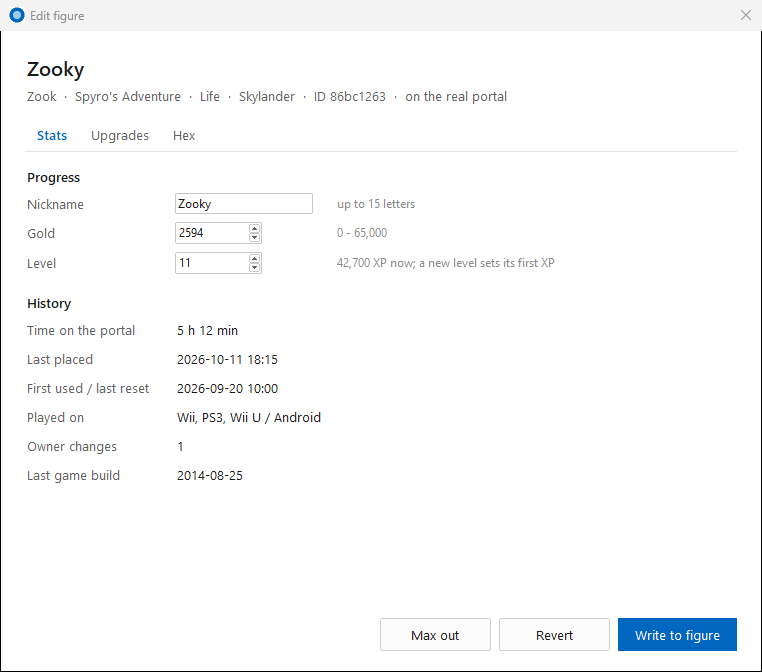 | 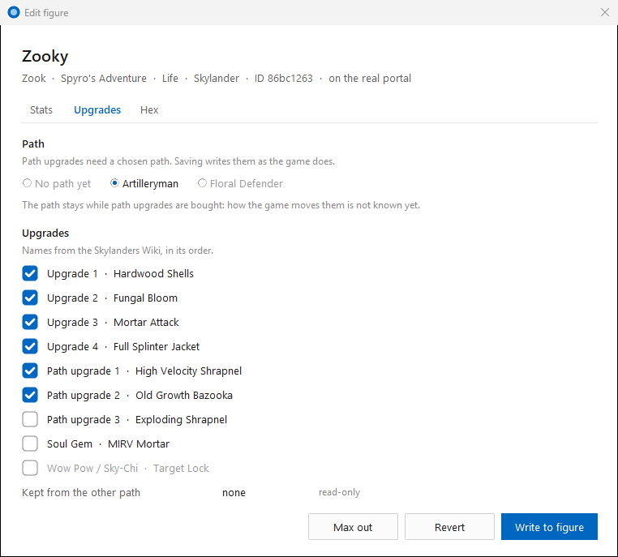 |
| **Edit figure**: nickname, gold and level, with the figure's history. | **Upgrades**: the path and every upgrade by its name. |
| 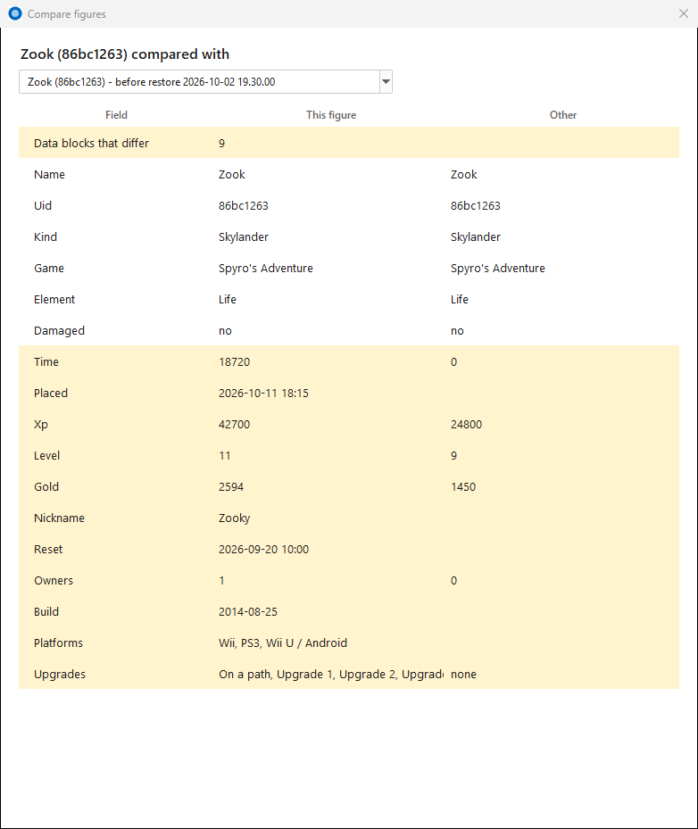 | |
| **Compare with…**: a figure next to one of its backups, differences highlighted. | |
| 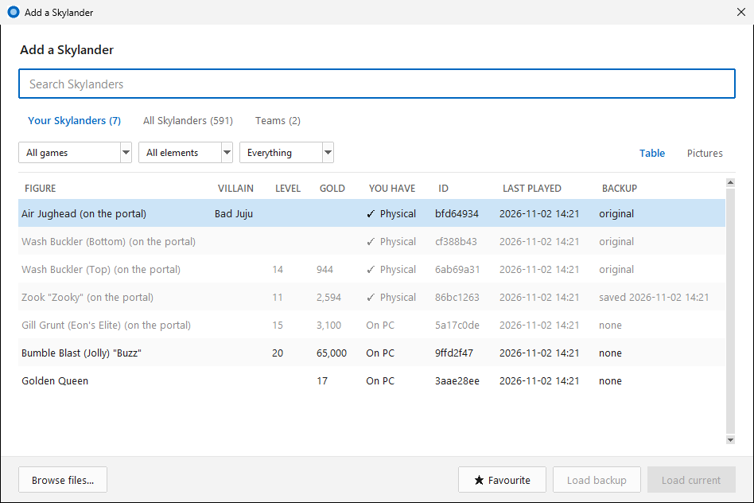 | 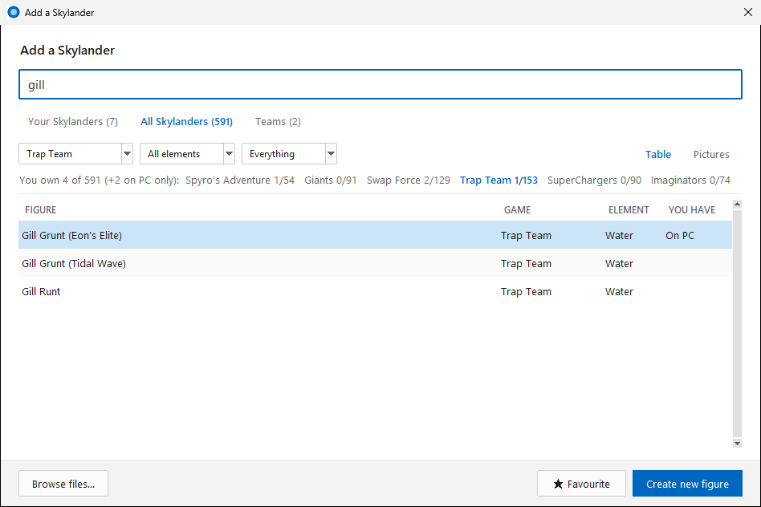 |
| **Add Skylander**: your figures, with level, gold and the villain in a trap. | **All Skylanders**: 591 figures, filtered by game, element and what you have. |
| 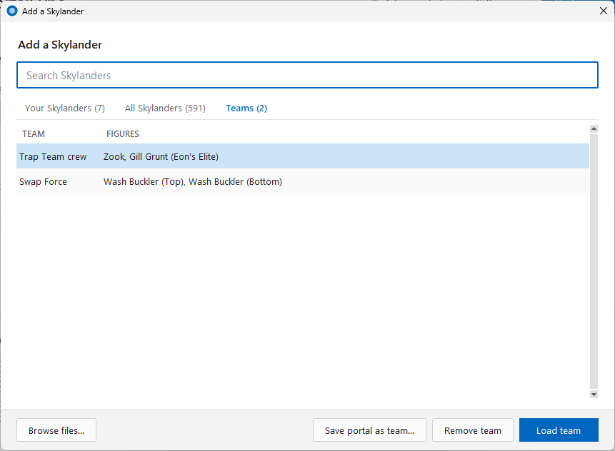 | 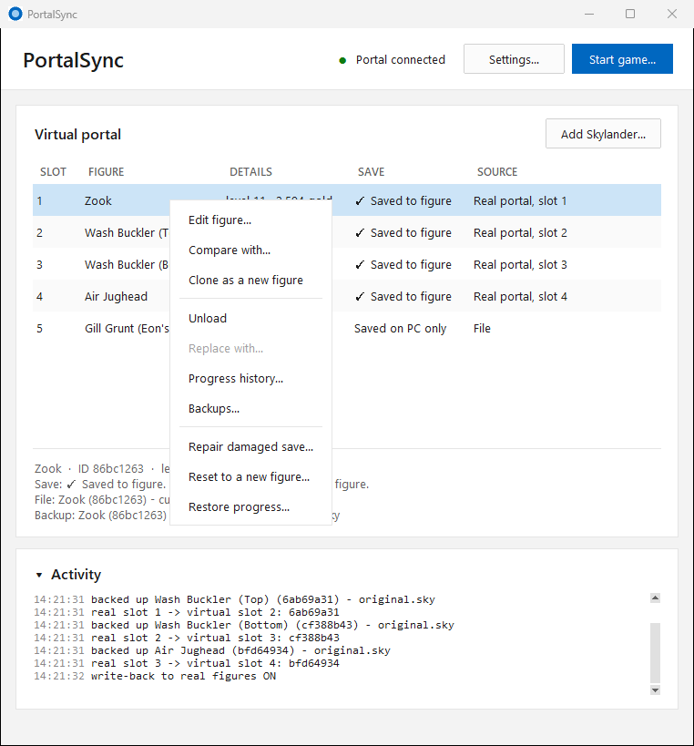 |
| **Teams**: save the figures on the portal and load them back in one click. | **Right-click a figure**: edit, compare, clone, unload, replace, progress history, backups, repair, reset or restore. |
| 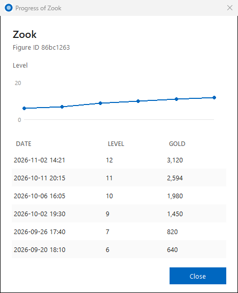 | 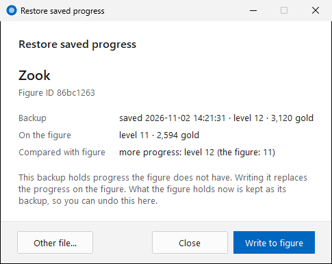 |
| **Progress history**: a figure's level and gold over time. | **Restore**: put newer progress back on a figure, one figure at a time. |
| 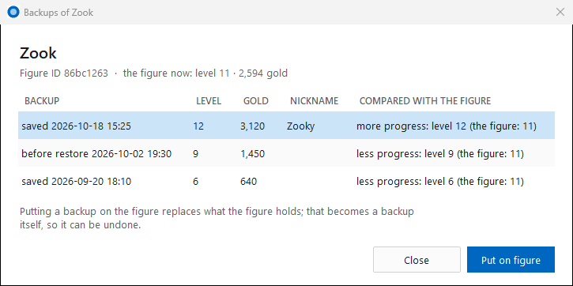 | 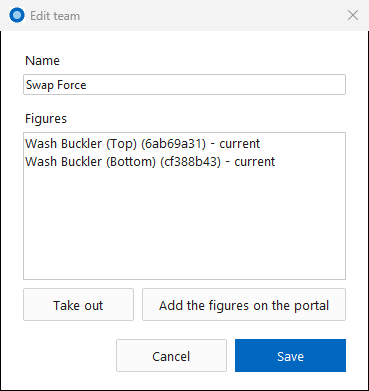 |
| **Backups**: each backup compared with the figure. | **Edit a team**: rename it, take figures out or add the ones on the portal. |
| 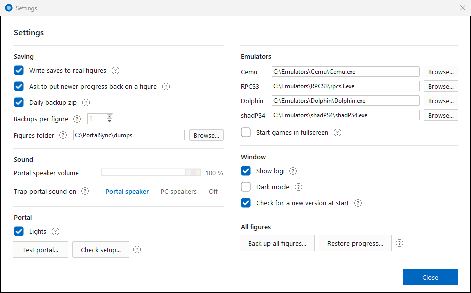 | 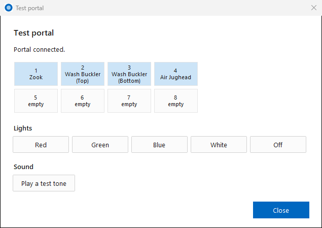 |
| **Settings**: hover over or click a **?** for an explanation. | **Test portal**: which slots hold a figure, plus the lights and a test tone. |
| 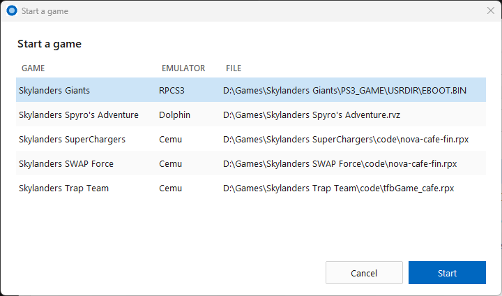 | 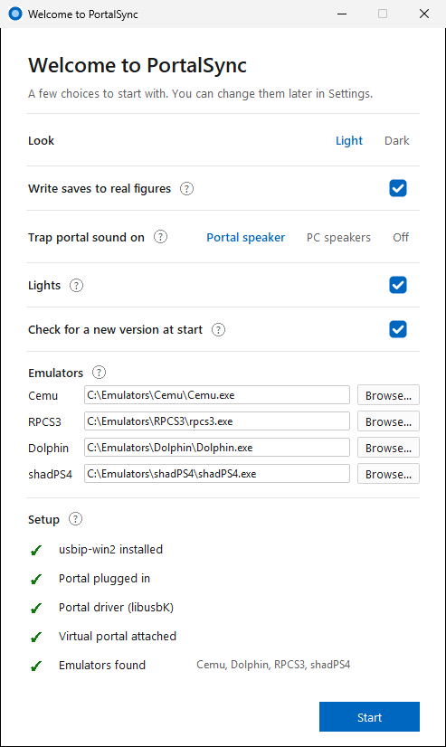 |
| **Start game**: your Skylanders games from Cemu, RPCS3, Dolphin and shadPS4. | **Welcome window** on the first start. |
| 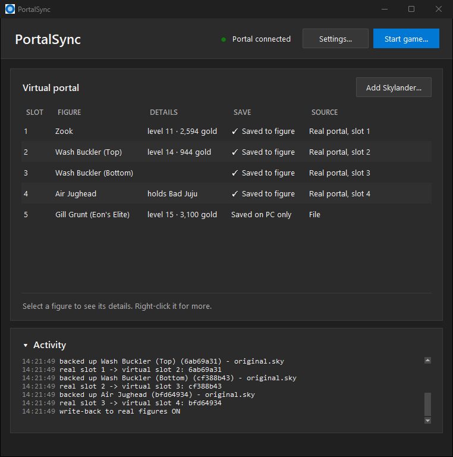 | |
| **Dark mode**, with the SAVE column: which saves are on the real figure. | 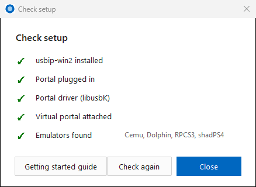 |
| | **Check setup**: everything PortalSync needs, with what to do when something is missing. |

## Features

### Words used here

- **Real figure:** a toy on your real portal. Lists in the app show it as **Real portal** or **✓ Physical**.
- **File figure:** a `.sky` file on your PC, played without the toy. Lists in the app show it as **File** or **On PC**.
- **Virtual portal:** the portal the game sees. It holds your real figures and your file figures together, in 16 slots.
- **Copy:** the file on your PC that the game plays on (`… - current.sky`). Every real figure has one.
- **Backup:** an older copy of a figure, kept so you can put it back.
- **Figures folder:** where the copies and backups are. It is the `dumps` folder next to `PortalSync.exe`, unless you chose another one in Settings.

### Portal and emulators

- **Cemu, RPCS3, Dolphin and shadPS4** see only the virtual portal. `portal_hide.dll` hides the real one, so there's no "too many Portals".
- **Start game…** lists the Skylanders games each emulator knows (Cemu's game paths, RPCS3's `games.yml`, Dolphin's ISO folders, shadPS4's game folders). It starts the one you pick with PortalSync already running, optionally in fullscreen.
- **Fast recognition:** a figure is ready in about a second. Both halves of a Swapper take about 2.3 s.
- **Unplugging is safe:** figures stay loaded while the real portal is away, and saves made meanwhile are written when it comes back.
- **Real figures and file figures together:** they share the virtual portal's 16 slots, so you can play your own figures alongside ones you don't have on hand.
- **Pop-ups over fullscreen games:** a warning or a restore question takes the focus in front of the game, then gives it back.

### Figures

- **Add Skylander** (no file explorer needed):
  - **Your Skylanders:** every figure you've played, with level, gold, nickname, the villain in a trap, when it was last played, and its backup. **Load current** loads its copy, **Load backup** its backup.
  - **All Skylanders:** 591 figures, the Imaginators Senseis and the Creation Crystals included, with game and element, plus a count per game of the ones you own. **Create new figure** makes a blank file figure, fresh out of the box, like Dolphin and RPCS3 do.
  - **Teams:** **Save portal as team…** keeps the figures now on the virtual portal under a name. **Load team** puts them all back at once. **Edit…** renames a team, takes figures out or adds the ones on the portal now, and a missing file is marked.
  - **Swapper halves come together:** loading or creating one half of a Swap Force Swapper also brings its other half, unless a half of that kind is on the portal already.
  - **What you have:** the **YOU HAVE** column says **✓ Physical** (a real figure, read from your real portal) or **On PC** (a file figure: created or imported). The count ("You own 4 of 591") only counts real figures.
  - **Favourites:** **★ Favourite** puts a ★ before a figure's name, in both lists, and the **Favourites** filter shows only those.
  - **Pictures (optional):** click **Get pictures…** in Add Skylander to download pictures of all figures (about 13 MB) from [portalsync-pictures](https://github.com/rhsts/portalsync-pictures). Add Skylander then gets a **Table / Pictures** switch. The pictures are kept apart from this repository, because the artwork belongs to Activision. You can also use your own: a `thumbnails` folder next to `PortalSync.exe` with `<figure ID>_<variant>.png` files (for example `25_0.png` for Zook).
  - **Search** by name, ID, game or element, and **filter** by game, element and what you have. Click a game in the "You own … of …" line to filter on it, and click a column heading to sort.
  - **Browse files…** for any other `.sky` file, or **drag and drop** `.sky` files onto the window.
- **Details** in the main window: level and gold, or "holds Bad Juju" for a trap.
- **Details panel** under the list: click a figure to see its ID, level and gold, where its saves are and what that means, its file and its backup.
- **Imaginators:** real Senseis and Creation Crystals are named and work as usual. A *created* Imaginators figure needs a patch, because the game checks a signature that only factory-made figures have: in Cemu, turn on the *Signature Patch* graphic pack (Skylanders Imaginators → Mods). RPCS3 has no such patch yet.
- **Trap Team traps:** PortalSync shows which villain is inside, and which villains it held before. The 46 villain IDs come from the game's own files.

### Saves and backups

- **Write saves to real figures** (on by default). Only data blocks are written, and every block is read back to check it.
  - **Retries:** a save that fails is tried up to three times, and a newer save replaces an older retry. The status line shows retries and failures.
  - **Nothing invalid reaches the figure:** invalid or incomplete writes from the game are refused first.
- **SAVE column** in the main window: where each figure's game saves are. The details panel says what each one means and what to do.
  - **✓ Saved to figure:** every game save is on the real figure. You can lift it.
  - **Saving… keep on portal:** PortalSync is writing a save to the figure. Leave it on the portal for a moment.
  - **Waiting for portal:** the real portal is unplugged. The saves are written when it's back.
  - **Saved on PC only:** a file figure (the game saves into its file), or a real figure while **Write saves to real figures** is off.
  - **Needs attention:** a save didn't reach the figure after three tries. The progress is safe in the copy on your PC.
  - **⚠ Not saved to disk:** Windows couldn't write the figure's file. PortalSync keeps the progress in memory and keeps trying.
- **Backups** in the figures folder, named after the character, for example `Zook (86bc1263) - original.sky`.
  - **Kinds:** `original` is the first copy PortalSync made of a figure. `saved <time>` is the copy from your PC, kept because it differed from the figure when you placed it. `before restore <time>` is what a figure held just before a restore, repair, reset or edit wrote to it.
  - **How many:** `original` always stays. Besides it, one per figure by default, the newest. Set **Backups per figure** in Settings to keep 1 to 10. Older ones go to the Recycle Bin, never straight to deletion.
  - An empty, cut-off or damaged copy never replaces an intact backup.
  - **Daily backup zip:** once a day, every figure file goes into `dumps\daily backups\Skylanders <date>.zip`. The last 7 are kept.
- **Progress history:** PortalSync notes a Skylander's level and gold each time they change (`dumps\progress.csv`). Right-click a figure → **Progress history…** shows them as a list and a chart, together with its backups.
- **Backups:** right-click a figure → **Backups…** lists its backups, newest first, with level, gold, nickname and how each compares with the figure ("more progress: level 12 (the figure: 11)"). **Put on figure** restores one: it writes the backup onto the real figure, and says which way it goes before it does.
- **Restore progress:** when you place a figure and the copy on your PC differs from it, a pop-up offers to restore that copy: to write it onto the figure. This happens after you played with **Write saves to real figures** off, or after the figure was played somewhere else, such as on a console. The pop-up says whether the copy has more or less progress than the figure, and nothing is written unless you click **Write to figure**. What the figure held is kept as its backup, so a restore can be undone.
- **Damaged saves:** when a figure's newest save fails its checksum, the game says "A toy on the portal has a problem". PortalSync warns you as soon as such a figure is placed and offers a **repair** that keeps all its progress.
- **Right-click a figure:**
  - **Edit figure…** opens the figure editor (below).
  - **Compare with…** puts the figure side by side with one of its backups or another loaded figure, differences highlighted.
  - **Clone as a new figure** copies it under a new ID into the figures folder, as a file figure to play from the virtual portal (Add Skylander lists it).
  - **Unload** takes a figure off the virtual portal, so the game no longer sees it.
  - **Replace with…** swaps a file figure for another one in the same window.
  - **Progress history…** and **Backups…** (above).
  - For a real figure also these, each written like a restore: backup first, then every block checked.
  - **Repair damaged save…**
  - **Reset to a new figure…**: like a toy fresh out of the box. What it held is kept as a `before restore` backup.
  - **Restore progress…**
- **Back up all figures** into one zip.

### Figure editor

Right-click a figure → **Edit figure…**. It works on real figures and on file figures.

- **Stats:** nickname, gold (0-65,000) and level (1-20). Play time, dates, the consoles the figure was used on and the last game that saved it are shown too.
- **Upgrades:** the path by its name and every upgrade by its name, from the Skylanders Wiki. Swap Force halves show the wiki's 3 basic upgrades. The path can't be switched while path upgrades are bought, and a Sensei's upgrades are read-only, because Imaginators stores them another way.
- **Trap:** the villain in the trap, and the ones it caught before. **Vehicle:** gearbits (0-33,000).
- **Hex:** the decrypted blocks, for anything else. The checksums are fixed when saving.
- **Max out:** level 20, 65,000 gold and every upgrade, filled in for you to save.

Only values proven on real figures can be changed; the others (vehicle mods, Creation Crystals) are shown read-only. [docs/FIGURE_FORMAT.md](docs/FIGURE_FORMAT.md) lists every field and how it was checked, and `verify_layout.py` checks it against your `dumps`.

Nothing is written until you press **Write to figure** (or **Save**). A real figure is written like a restore: its backup first, every block checked. A file figure keeps its old copy as `… - before edit <time>.sky` and is placed again, so the game reads the change. A save is refused when the game saved the figure after the editor read it.

### Sound and lights

- **Trap Team sound** on the Traptanium Portal's speaker, on the PC speakers, or off, with a volume slider.
- **Portal lights** follow the game, or stay off.
- **Test portal…** (Settings): which real slots hold a figure, plus buttons that try the lights and play a test tone.

### Settings

- **Settings…** page. All choices are remembered, and a **?** next to an option explains it.
  - **Saving:** write saves to figures, the restore pop-up, the daily backup zip, backups per figure, and the figures folder (for example on OneDrive; your files move there on the next start).
  - **Sound and lights**, **Test portal…** and **Check setup…**.
  - **Emulators:** a path box with **Browse…** for each one, and fullscreen start.
  - **Window:** show log, dark mode, and the update check. The Activity log can also be folded up with a click on its title.
- **Welcome window** on the first start, with the main choices and the setup check. Dark mode chosen there is used straight away.
- **Updates:** when a newer release is out, a link appears in the window. Click it and PortalSync downloads the release from this repository, checks that it is the file GitHub lists (SHA-256) and that it is signed with PortalSync's release key, puts the new files in place and restarts. Your figures and settings stay as they are.

## Tested

| Emulator | Game | Notes |
| --- | --- | --- |
| Cemu 2.6 | Skylanders Trap Team, SuperChargers, Swap Force | Traps, vehicles, Swap Force halves, portal speaker, repair. |
| RPCS3 | Skylanders Giants (BLES01689) | |
| Dolphin | Skylanders Spyro's Adventure | Needs USB passthrough, see step 4. |
| shadPS4 | Skylanders Imaginators (CUSA05158) | Figures read from the real portal and from files, saves written back to the real figure. |

Tested with a Traptanium Portal (USB ID `1430:0150`) on Windows 11.

## For developers

How it works, building from source, the tests and the list of files are in [docs/DEVELOPMENT.md](docs/DEVELOPMENT.md).

Your figures, the log and your settings stay on your PC (`dumps\`, `portalsync.log`, `settings.json`). They're never part of the repository.

## Credits

- The portal protocol and the figure list come from [Dolphin](https://github.com/dolphin-emu/dolphin) (`Source/Core/Core/IOS/USB/Emulated/Skylanders/`), cross-checked with [RPCS3](https://github.com/RPCS3/rpcs3) and [Cemu](https://github.com/cemu-project/Cemu).
- [usbip-win2](https://github.com/vadimgrn/usbip-win2) provides the virtual USB controller.
- The Imaginators variant IDs and the Creation Crystal IDs come from [Skylander-IDs](https://github.com/Texthead1/Skylander-IDs).
- The figure editor's field offsets come from the format notes of [Runes](https://github.com/NefariousTechSupport/Runes) and from Dolphin, each checked on real figures (no Runes code or tables are included).
- Upgrade and path names come from the [Skylanders Wiki](https://skylanders.fandom.com) (CC-BY-SA 3.0), in `upgrade_names.json` (made by `tools/fetch_upgrade_names.py`).

## License

GPL-2.0-or-later, the same as Dolphin, whose portal code this project is ported from. See [LICENSE](LICENSE).

Skylanders and Portal of Power are trademarks of Activision. This project is not affiliated with or endorsed by Activision.
