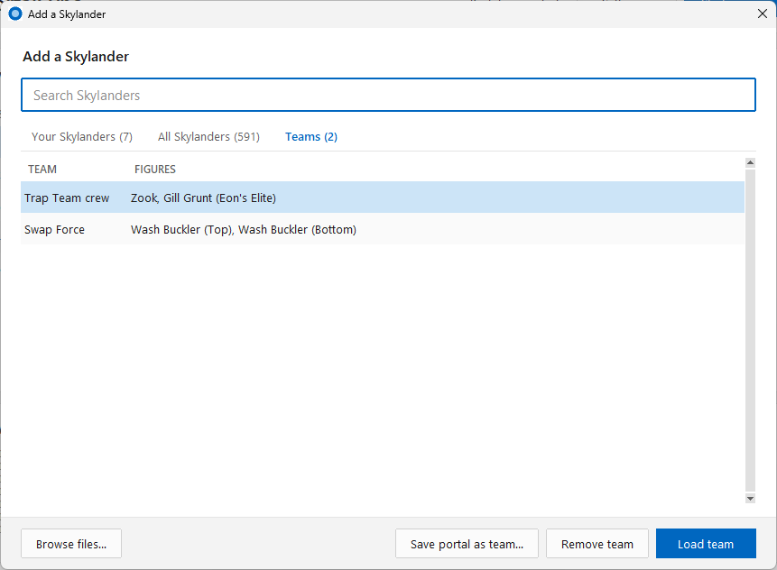
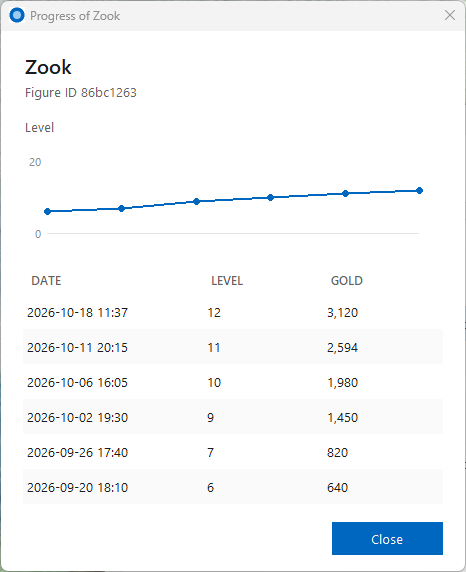
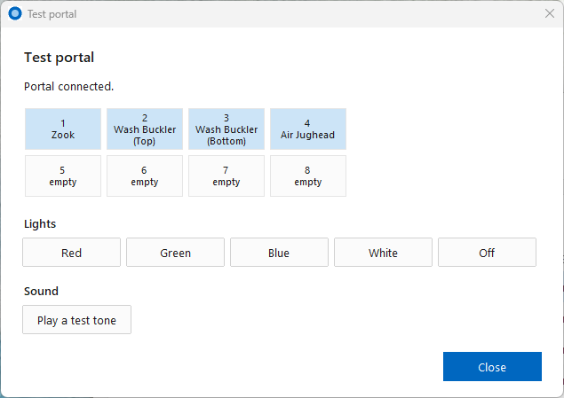

# PortalSync

Use one real Skylanders Portal of Power with **Cemu** (Wii U), **RPCS3** (PS3) and **Dolphin** (Wii) on Windows, and keep your game progress on your real figures. Play your real figures and `.sky` figures from your PC at the same time.

PortalSync creates a *virtual* portal over USB/IP. Every figure you place on the real portal is copied into the virtual portal, and the emulator talks only to the virtual one. Game saves go back onto the real figure. The real portal can stay plugged in the whole time: a small DLL hides it from the emulators, so games never say "too many Portals".


## Highlights

- **Real and virtual figures together:** play figures from the real portal and `.sky` figures from your PC at the same time, up to 16. Save **teams** of figures and load them in one click.
- **One portal for three emulators:** Cemu, RPCS3 and Dolphin, with the real portal plugged in.
- **Your progress stays on your figures:** game saves are written back to the real figure, and every block is checked.
- **Backups of every figure**, a daily backup zip, and a pop-up to put newer progress back when a figure is behind its copy. A **SAVE** column shows whether each save has reached the figure.
- **See inside your figures:** level, gold, nickname, the villain inside a Trap Team trap, and each Skylander's **progress history**.
- **Repair a damaged figure.** That's the one the game rejects with "A toy on the portal has a problem". You can also edit gold, nickname and level, or reset a figure to new.
- **Trap Team sound** on the Traptanium Portal's own speaker, and the **portal lights** follow the game.
- **Start your games from PortalSync**, a **Settings** page, a **welcome window**, **dark mode**, and **updates in one click**.

New here? Follow [Getting started](#getting-started): usbip-win2, Zadig, PortalSync, done.

## Getting started

You need Windows 10 or 11 (64-bit), a Skylanders Portal of Power on USB, and Cemu, RPCS3 or Dolphin with a Skylanders game. Setup takes about ten minutes, and you only do it once.

### 1. Install usbip-win2

PortalSync shows its virtual portal to Windows through **usbip-win2**.

1. Download the installer (`USBip-….exe`) from the [usbip-win2 releases](https://github.com/vadimgrn/usbip-win2/releases). Version 0.9.8.1 was tested.
2. Run it with the default settings, so it installs to `C:\Program Files\USBip`. Allow the driver installation when Windows asks.

### 2. Give the portal a libusb driver with Zadig

Windows treats the portal as a game controller (HID), so PortalSync can't read figures from it yet. Zadig swaps in a driver that PortalSync can use. This only changes the portal on this PC; it still works the same on a console.

1. Plug in the portal.
2. Download [Zadig](https://zadig.akeo.ie/) and start it. No install is needed.
3. In the menu, turn on **Options → List All Devices**.
4. In the drop-down list, choose **Spyro Porta**. Check that the USB ID next to it reads **1430 0150**.
5. Next to the green arrow, pick **libusbK** as the new driver. Use the small arrows to switch drivers.
6. Click **Replace Driver** and wait until Zadig says it's done.

To undo it later: in **Device Manager**, open **libusbK USB Devices**, right-click **Spyro Porta**, choose **Uninstall device**, and tick "Attempt to remove the driver for this device". Then unplug the portal and plug it back in, and Windows uses its own driver again.

### 3. Download and start PortalSync

1. Download `PortalSync-….zip` from the [latest release](../../releases/latest) and unzip it to a folder of its own, for example `C:\PortalSync`. Keep the files together: `PortalSync.exe`, `portal_hide.dll`, `portal_descriptors.json`, `figure_names.json` and `figure_details.json`.
2. Double-click `PortalSync.exe`. If Windows SmartScreen warns, choose **More info → Run anyway**. Some antivirus programs distrust it too, because it's a packed exe that loads a DLL into another program. The source is all here if you'd rather build it yourself.
3. The **welcome window** opens. Pick light or dark, check that your emulators were found (or pick them with **Browse…**), and press **Start**.
4. The status at the top right should say **Portal connected**.

### 4. Set up your emulator once

- **Cemu:** nothing to set. In the Cemu hybrid build, keep the *Hybrid* checkbox off.
- **Dolphin:** under **Config → Wii → Whitelisted USB Passthrough Devices**, click **Add…** and choose `1430:0150`. Keep Dolphin's own emulated Skylanders portal off.
- **RPCS3:** nothing to set. Just make sure PortalSync is running before the game boots.

### 5. Play

1. In PortalSync, click **Start game…**, pick your game and click **Start**. Or start PortalSync first and then the game yourself.
2. Put figures on the real portal. They show up in the game within about a second, and your progress is saved back onto the figures.
3. Right-click a figure in the list for more options, and use **Settings…** for everything else.

### If something doesn't work

| What you see | What to do |
| --- | --- |
| The game says **"too many Portals"** | The game was started before PortalSync. Close the game, start PortalSync first (or use **Start game…**), then start the game again. Also check that `portal_hide.dll` is next to `PortalSync.exe`. |
| Status **"Portal not plugged in"** or **"Looking for the portal"** | Check the USB cable, and redo step 2. The portal must have the libusbK driver, not its standard one. |
| Status **"Portal in use by Cemu.exe"** (or another emulator) | The emulator took the portal first. Stop the game, unplug the portal and plug it back in, and start the game again. |
| PortalSync stops with **"attach failed"** | usbip-win2 isn't installed, or isn't in `C:\Program Files\USBip`. Redo step 1. |
| PortalSync stops with **"Port 3240 is in use"** | PortalSync is already running. Look for its window or on the taskbar. |
| The game says **"A toy on the portal has a problem"** | The figure's save is damaged. PortalSync offers a repair when you place it. You can also right-click the figure and choose **Repair damaged save…**. |

## Screenshots

| | |
| --- | --- |
|  |  |
| **Add Skylander**: your figures, with level, gold and the villain in a trap. | **All Skylanders**: 591 figures. Click a game, or use the drop-down, to filter. |
|  |  |
| **Teams**: save the figures on the portal and load them back in one click. | **Right-click a figure**: unload, replace, progress history, edit, repair, reset or restore. |
|  |  |
| **Progress history**: a figure's level and gold over time. | **Restore**: put newer progress back on a figure, one figure at a time. |
|  |  |
| **Settings**: hover over or click a **?** for an explanation. | **Test portal**: which slots hold a figure, plus the lights and a test tone. |
|  |  |
| **Start game**: your Skylanders games from Cemu, RPCS3 and Dolphin. | **Welcome window** on the first start. |
|  | |
| **Dark mode**, with the SAVE column: which saves are on the real figure. | |

## Features

### Portal and emulators

- **Cemu, RPCS3 and Dolphin** see only the virtual portal. `portal_hide.dll` hides the real one, so there's no "too many Portals".
- **Start game…** lists the Skylanders games each emulator knows (Cemu's game paths, RPCS3's `games.yml`, Dolphin's ISO folders). It starts the one you pick with PortalSync already running, optionally in fullscreen.
- **Fast recognition:** a figure is ready in about a second. Both halves of a Swapper take about 2.3 s.
- **Unplugging is safe:** figures stay loaded while the real portal is away, and saves made meanwhile are written when it comes back.
- **Real and file figures together:** figures from the real portal and `.sky` files share the virtual portal's 16 slots, so you can play your own figures alongside ones you don't have on hand.
- **Pop-ups over fullscreen games:** a warning or a restore question takes the focus in front of the game, then gives it back.

### Figures

- **Add Skylander** (no file explorer needed):
  - **Your Skylanders:** every figure you've played, with level, gold, nickname, the villain in a trap, when it was last played, and its backup. Load its current copy or its backup.
  - **All Skylanders:** 591 figures, the Imaginators Senseis and the Creation Crystals included, with game, element and a tick for the ones you have, plus a count per game. **Create new figure** makes a blank one, fresh out of the box, like Dolphin and RPCS3 do.
  - **Teams:** **Save portal as team…** keeps the figures now on the virtual portal under a name. **Load team** puts them all back at once.
  - **Swapper halves come together:** loading or creating one half of a Swap Force Swapper also brings its other half, unless a half of that kind is on the portal already.
  - **Search** by name, ID, game or element, and **filter by game** (Spyro's Adventure to Imaginators): pick one in the drop-down, or click a game in the "You have … of …" line. Click it again for all games.
  - **Browse files…** for any other `.sky` file, or **drag and drop** `.sky` files onto the window.
- **Details** in the main window: level and gold, or "holds Bad Juju" for a trap.
- **Imaginators:** real Senseis and Creation Crystals are named and work as usual. A *created* Imaginators figure needs a patch, because the game checks a signature that only factory-made figures have: in Cemu, turn on the *Signature Patch* graphic pack (Skylanders Imaginators → Mods). RPCS3 has no such patch yet.
- **Trap Team traps:** PortalSync shows which villain is inside, and which villains it held before. The 46 villain IDs come from the game's own files.

### Saves and backups

- **Write saves to real figures** (on by default). Only data blocks are written, and every block is read back to check it.
  - **Retries:** a save that fails is tried up to three times, and a newer save replaces an older retry. The status line shows retries and failures.
  - **Nothing invalid reaches the figure:** invalid or incomplete writes from the game are refused first.
- **SAVE column** in the main window: "✓ on figure", "saving 2 blocks", "FAILED", or "on PC" for a figure loaded from a file.
- **Backups** in the `dumps` folder, named after the character, for example `Zook (86bc1263) - original.sky`.
  - Keep 1 to 10 per figure. Older ones go to the Recycle Bin, never straight to deletion.
  - An empty, cut-off or damaged copy never replaces an intact backup.
  - **Daily backup zip:** once a day, every figure file goes into `dumps\daily backups\Skylanders <date>.zip`. The last 7 are kept.
- **Progress history:** PortalSync notes a Skylander's level and gold each time they change (`dumps\progress.csv`). Right-click a figure → **Progress history…** shows them as a list and a chart, together with its backups.
- **Restore progress:** when a figure you place is behind its saved copy, a pop-up offers to write that progress onto the figure. What the figure held is kept as its backup, so a restore can be undone.
- **Damaged saves:** when a figure's newest save fails its checksum, the game says "A toy on the portal has a problem". PortalSync warns you as soon as such a figure is placed and offers a **repair** that keeps all its progress.
- **Right-click a figure:** **Unload**, **Replace with…** (a figure from a file swaps for another one in the same window), and **Progress history…**. For a figure on the real portal also these, each written like a restore: backup first, then every block checked.
  - **Edit gold, nickname, level…**: up to level 20, saved the way the game saves, with the previous save kept as its fallback.
  - **Repair damaged save…**
  - **Reset to a new figure…**: like a toy fresh out of the box.
  - **Restore progress…**
- **Back up all figures** into one zip.

### Sound and lights

- **Trap Team sound** on the Traptanium Portal's speaker, on the PC speakers, or off, with a volume slider.
- **Portal lights** follow the game, or stay off.
- **Test portal…** (Settings): which real slots hold a figure, plus buttons that try the lights and play a test tone.

### Settings

- **Settings…** page. All choices are remembered, and a **?** next to an option explains it.
  - **Saving:** write saves to figures, the restore pop-up, the daily backup zip, backups per figure, and the figures folder (for example on OneDrive; your files move there on the next start).
  - **Sound and lights**, and **Test portal…**.
  - **Emulators:** a path box with **Browse…** for each one, and fullscreen start.
  - **Window:** show log, dark mode, and the update check.
- **Welcome window** on the first start, with the main choices. Dark mode chosen there is used straight away.
- **Updates:** when a newer release is out, a link appears in the window. Click it and PortalSync downloads the release from this repository, puts the new files in place and restarts. Your figures and settings stay as they are.

## Tested

| Emulator | Game | Notes |
| --- | --- | --- |
| Cemu 2.6 | Skylanders Trap Team, SuperChargers, Swap Force | Traps, vehicles, Swap Force halves, portal speaker, repair. |
| RPCS3 | Skylanders Giants (BLES01689) | |
| Dolphin | Skylanders Spyro's Adventure | Needs USB passthrough, see below. |

All of them were tested with a Traptanium Portal (USB ID `1430:0150`) on Windows 11.

## Building from source

To run it from the source instead of the exe (steps 1, 2 and 4 of Getting started still apply):

```
pip install -r requirements.txt
python portalsync.py
```

Python 3.13 was used. To build the exe and the DLL together, install PyInstaller as well, then run `powershell -ExecutionPolicy Bypass -File build.ps1`. This needs the Visual Studio C++ x64 build tools. To build only `portal_hide.dll`, use an *x64 Native Tools Command Prompt for VS 2022*:

```
cl /nologo /O2 /LD portal_hide.c cfgmgr32.lib
```

## How it works

- **The virtual portal:** `portalsync.py` is a USB/IP server. usbip-win2 attaches its virtual portal, and Windows sees a second `1430:0150` HID device. The portal protocol (status reports, block reads and writes, lights, audio) is ported from Dolphin's emulated portal.
- **The real portal:** PortalSync claims it with libusb, reads each figure placed on it, and loads it into a free virtual slot. Game writes go to `dumps\<character> (<id>) - current.sky`, and to the real figure when write-back is on.
- **Hiding the real portal:** `portal_hide.dll` is loaded into each running Cemu, RPCS3 and Dolphin process. It patches `SetupDiGetDeviceInstanceIdA` so that it fails for a portal behind a real (PCI) USB controller while the virtual portal exists, and libusb then skips the real portal. Nothing is written to the emulator folders, and the patch goes away when the emulator closes.
- **Reading figure saves:** saves are decrypted the way Dolphin does it (AES from Windows itself, no extra package). Checksum types 1–3 cover the main save area, and type 6 covers the second area that holds the later games' experience.
- **Portal quirks found while testing:** this portal sometimes answers with the previous block's data, sends repeated status reports, and lets audio block control transfers. PortalSync handles all three.

## Tests

```
python test_portalsync.py
python -m unittest -v test_save_safety
```

The first prints `ok`, and the second runs 16 save-safety tests. The tests use fake portals and a loopback USB/IP client, so no hardware is needed.

## Files

| File | What it is |
| --- | --- |
| `portalsync.py` | The program: USB/IP server, portal logic, window. |
| `portal_hide.c` | Source of `portal_hide.dll`. |
| `portal_descriptors.json` | USB descriptors of a real portal, which the virtual portal copies. Recreate them from your own portal with `python portalsync.py capture`. |
| `figure_names.json` | Figure IDs and names: Dolphin's Skylander list, the Imaginators Senseis from Cemu's and RPCS3's lists, and the Imaginators variants and Creation Crystals from [Skylander-IDs](https://github.com/Texthead1/Skylander-IDs). |
| `figure_details.json` | Game and element of each figure in the All Skylanders list. |
| `test_portalsync.py`, `test_save_safety.py` | Tests. |
| `build.ps1` | Builds `PortalSync.exe` and `portal_hide.dll`. |
| `portal.ico` | Icon. |

Your figures, the log and your settings stay on your PC (`dumps\`, `portalsync.log`, `settings.json`). They're never part of the repository.

## Credits

- The portal protocol and the figure list come from [Dolphin](https://github.com/dolphin-emu/dolphin) (`Source/Core/Core/IOS/USB/Emulated/Skylanders/`), cross-checked with [RPCS3](https://github.com/RPCS3/rpcs3) and [Cemu](https://github.com/cemu-project/Cemu).
- [usbip-win2](https://github.com/vadimgrn/usbip-win2) provides the virtual USB controller.
- The Imaginators variant IDs and the Creation Crystal IDs come from [Skylander-IDs](https://github.com/Texthead1/Skylander-IDs).

## License

GPL-2.0-or-later, the same as Dolphin, whose portal code this project is ported from. See [LICENSE](LICENSE).

Skylanders and Portal of Power are trademarks of Activision. This project is not affiliated with or endorsed by Activision.
