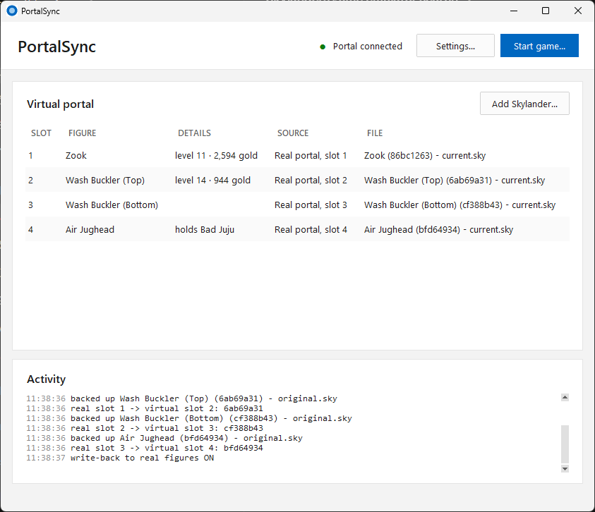
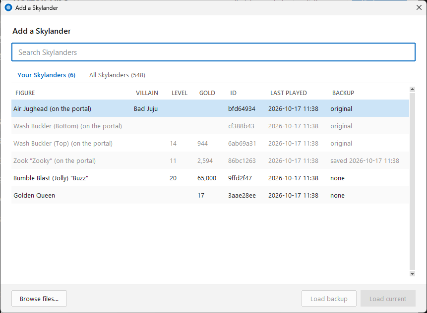
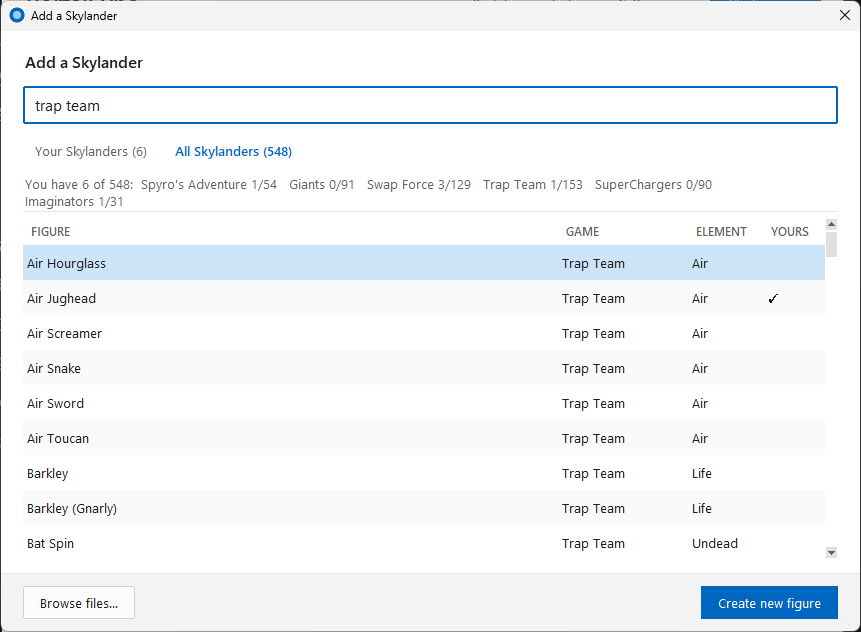
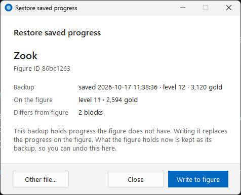
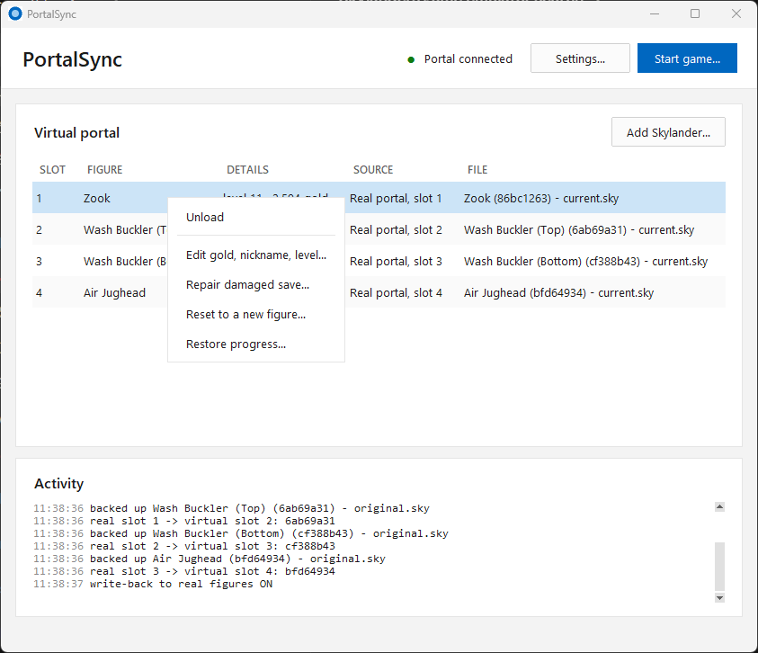
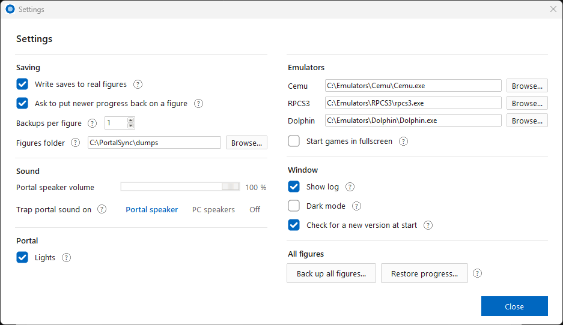
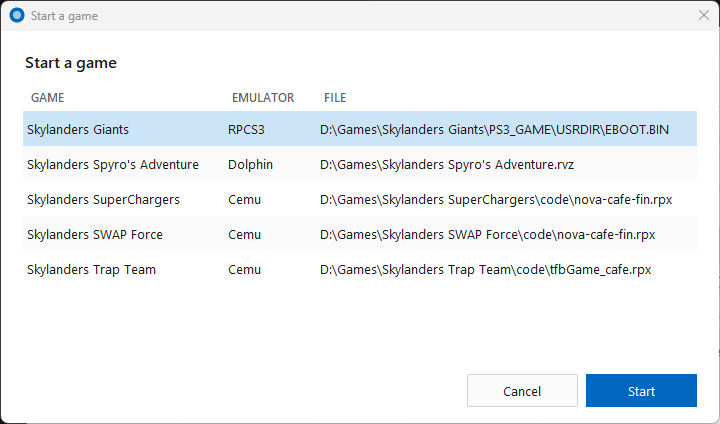
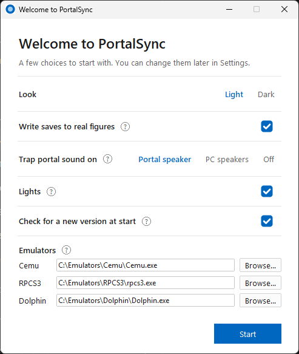
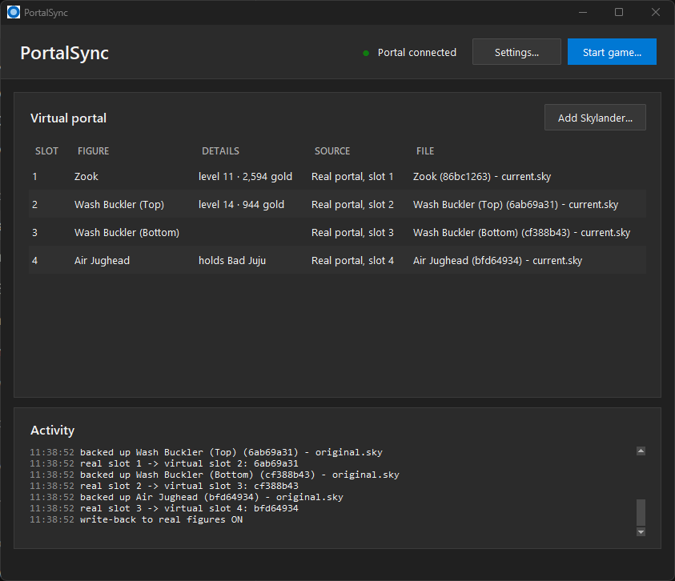

# PortalSync

*Formerly Portal Bridge.*

Use one real Skylanders Portal of Power with **Cemu** (Wii U), **RPCS3** (PS3) and **Dolphin** (Wii) on Windows, and keep your game progress on your real figures.

PortalSync creates a *virtual* portal over USB/IP. Every figure you place on the real portal is copied into the virtual portal, and the emulator talks only to the virtual one. Game saves go back onto the real figure. The real portal can stay plugged in the whole time: a small DLL hides it from the emulators, so games never say "too many Portals".



## Highlights

- **One portal for three emulators:** Cemu, RPCS3 and Dolphin, with the real portal plugged in.
- **Your progress stays on your figures:** game saves are written back to the real figure, and every block is checked.
- **Backups of every figure**, with a pop-up to put newer progress back when a figure is behind its copy.
- **See inside your figures:** level, gold, nickname, and the villain inside a Trap Team trap.
- **Repair a damaged figure.** That's the one the game rejects with "A toy on the portal has a problem". You can also edit gold, nickname and level, or reset a figure to new.
- **Trap Team sound** on the Traptanium Portal's own speaker, and the **portal lights** follow the game.
- **Start your games from PortalSync**, a **Settings** page, a **welcome window** and **dark mode**.

## Screenshots

| | |
| --- | --- |
|  |  |
| **Add Skylander**: your figures, with level, gold and the villain in a trap. | **All Skylanders**: all 548 figures, with game, element and a tick for yours. |
|  |  |
| **Restore**: put newer progress back on a figure, one figure at a time. | **Right-click a figure** to unload, edit, repair, reset or restore it. |
|  |  |
| **Settings**: hover over or click a **?** for an explanation. | **Start game**: your Skylanders games from Cemu, RPCS3 and Dolphin. |
|  |  |
| **Welcome window** on the first start. | **Dark mode.** |

## Features

### Portal and emulators

- **Cemu, RPCS3 and Dolphin** see only the virtual portal. `portal_hide.dll` hides the real one, so there's no "too many Portals".
- **Start game…** lists the Skylanders games each emulator knows (Cemu's game paths, RPCS3's `games.yml`, Dolphin's ISO folders). It starts the one you pick with PortalSync already running, optionally in fullscreen.
- **Fast recognition:** a figure is ready in about a second. Both halves of a Swapper take about 2.3 s.
- **Unplugging is safe:** figures stay loaded while the real portal is away, and saves made meanwhile are written when it comes back.
- **Pop-ups over fullscreen games:** a warning or a restore question takes the focus in front of the game, then gives it back.

### Figures

- **Add Skylander** (no file explorer needed):
  - **Your Skylanders:** every figure you've played, with level, gold, nickname, the villain in a trap, when it was last played, and its backup. Load its current copy or its backup.
  - **All Skylanders:** all 548 figures, the 31 Imaginators Senseis included, with game, element and a tick for the ones you have, plus a count per game. **Create new figure** makes a blank one, fresh out of the box, like Dolphin and RPCS3 do.
  - **Search** by name, ID, game or element.
  - **Browse files…** for any other `.sky` file, or **drag and drop** `.sky` files onto the window.
- **Details** in the main window: level and gold, or "holds Bad Juju" for a trap.
- **Trap Team traps:** PortalSync shows which villain is inside, and which villains it held before. The 46 villain IDs come from the game's own files.

### Saves and backups

- **Write saves to real figures** (on by default). Only data blocks are written, and every block is read back to check it.
  - **Retries:** a save that fails is tried up to three times, and a newer save replaces an older retry. The status line shows retries and failures.
  - **Nothing invalid reaches the figure:** invalid or incomplete writes from the game are refused first.
- **Backups** in the `dumps` folder, named after the character, for example `Zook (86bc1263) - original.sky`.
  - Keep 1 to 10 per figure. Older ones go to the Recycle Bin, never straight to deletion.
  - An empty, cut-off or damaged copy never replaces an intact backup.
- **Restore progress:** when a figure you place is behind its saved copy, a pop-up offers to write that progress onto the figure. What the figure held is kept as its backup, so a restore can be undone.
- **Damaged saves:** when a figure's newest save fails its checksum, the game says "A toy on the portal has a problem". PortalSync warns you as soon as such a figure is placed and offers a **repair** that keeps all its progress.
- **Right-click a figure** on the real portal for these actions. Each one writes like a restore: backup first, then every block checked.
  - **Edit gold, nickname, level…**: up to level 20, saved the way the game saves, with the previous save kept as its fallback.
  - **Repair damaged save…**
  - **Reset to a new figure…**: like a toy fresh out of the box.
  - **Restore progress…**
- **Back up all figures** into one zip.

### Sound and lights

- **Trap Team sound** on the Traptanium Portal's speaker, on the PC speakers, or off, with a volume slider.
- **Portal lights** follow the game, or stay off.

### Settings

- **Settings…** page. All choices are remembered, and a **?** next to an option explains it.
  - **Saving:** write saves to figures, the restore pop-up, backups per figure, and the figures folder (for example on OneDrive; your files move there on the next start).
  - **Sound and lights.**
  - **Emulators:** a path box with **Browse…** for each one, and fullscreen start.
  - **Window:** show log, dark mode, and the update check.
- **Welcome window** on the first start, with the main choices. Dark mode chosen there is used straight away.
- **Update check:** a link in the window when a newer release is out.

## Tested

| Emulator | Game | Notes |
| --- | --- | --- |
| Cemu 2.6 | Skylanders Trap Team, SuperChargers, Swap Force | Traps, vehicles, Swap Force halves, portal speaker, repair. |
| RPCS3 | Skylanders Giants (BLES01689) | |
| Dolphin | Skylanders Spyro's Adventure | Needs USB passthrough, see below. |

All of them were tested with a Traptanium Portal (USB ID `1430:0150`) on Windows 11.

## Requirements

- Windows 10 or 11, 64-bit.
- [usbip-win2](https://github.com/vadimgrn/usbip-win2), tested with 0.9.8.1, installed in `C:\Program Files\USBip`.
- The real portal on a libusb-compatible driver. Install **libusbK** (or WinUSB) for `Spyro Porta` (`1430:0150`) with [Zadig](https://zadig.akeo.ie/).

## Install

### The exe (easiest)

1. Download the zip from the [latest release](../../releases/latest) and unzip it to a folder of its own. The folder holds `PortalSync.exe`, `portal_hide.dll`, `portal_descriptors.json`, `figure_names.json` and `figure_details.json`; keep them together.
2. Double-click `PortalSync.exe`. The welcome window asks for a few choices, and your figures go to a `dumps` folder next to it.

Some antivirus programs distrust exes packed with PyInstaller, and programs that load a DLL into another process. Both are what PortalSync does, so it may be flagged. You can check the source here and build both files yourself.

### From source

```
pip install -r requirements.txt
python portal_bridge.py
```

Python 3.13 was used. To build the exe and the DLL together, install PyInstaller as well, then run `powershell -ExecutionPolicy Bypass -File build.ps1`. This needs the Visual Studio C++ x64 build tools. To build only `portal_hide.dll`, use an *x64 Native Tools Command Prompt for VS 2022*:

```
cl /nologo /O2 /LD portal_hide.c cfgmgr32.lib
```

## Usage

1. Plug in the real portal.
2. Start PortalSync **before** the emulator boots a game. The easiest way is to use **Start game…**.
3. Place figures on the real portal. Each one appears in the game.

Close the window to stop. That disconnects the virtual portal.

If a game was already running when you started PortalSync, the game holds the real portal, and PortalSync shows a pop-up. To fix it, stop the game, unplug and replug the real portal, and start the game again.

### Emulator settings

- **Cemu:** no settings needed. In the Cemu hybrid build, keep the *Hybrid* checkbox off.
- **RPCS3:** start PortalSync before booting the game. With no portal at boot, RPCS3 adds its own emulated portal.
- **Dolphin:** add `1430:0150` to the USB passthrough whitelist, and keep Dolphin's own emulated Skylanders portal off.

## How it works

- **The virtual portal:** `portal_bridge.py` is a USB/IP server. usbip-win2 attaches its virtual portal, and Windows sees a second `1430:0150` HID device. The portal protocol (status reports, block reads and writes, lights, audio) is ported from Dolphin's emulated portal.
- **The real portal:** PortalSync claims it with libusb, reads each figure placed on it, and loads it into a free virtual slot. Game writes go to `dumps\<character> (<id>) - current.sky`, and to the real figure when write-back is on.
- **Hiding the real portal:** `portal_hide.dll` is loaded into each running Cemu, RPCS3 and Dolphin process. It patches `SetupDiGetDeviceInstanceIdA` so that it fails for a portal behind a real (PCI) USB controller while the virtual portal exists, and libusb then skips the real portal. Nothing is written to the emulator folders, and the patch goes away when the emulator closes.
- **Reading figure saves:** saves are decrypted the way Dolphin does it (AES from Windows itself, no extra package). Checksum types 1–3 cover the main save area, and type 6 covers the second area that holds the later games' experience.
- **Portal quirks found while testing:** this portal sometimes answers with the previous block's data, sends repeated status reports, and lets audio block control transfers. PortalSync handles all three.

## Tests

```
python test_portal_bridge.py
python -m unittest -v test_save_safety
```

The first prints `ok`, and the second runs 16 save-safety tests. The tests use fake portals and a loopback USB/IP client, so no hardware is needed.

## Files

| File | What it is |
| --- | --- |
| `portal_bridge.py` | The program: USB/IP server, portal logic, window. |
| `portal_hide.c` | Source of `portal_hide.dll`. |
| `portal_descriptors.json` | USB descriptors of a real portal, which the virtual portal copies. Recreate them from your own portal with `python portal_bridge.py capture`. |
| `figure_names.json` | Figure IDs and names (548): Dolphin's Skylander list plus the 31 Imaginators Senseis from Cemu's and RPCS3's lists. Creation Crystals are missing, because neither emulator lists them. |
| `figure_details.json` | Game and element of each figure, from Dolphin's list. |
| `test_portal_bridge.py`, `test_save_safety.py` | Tests. |
| `build.ps1` | Builds `PortalSync.exe` and `portal_hide.dll`. |
| `portal.ico` | Icon. |

Your figures, the log and your settings stay on your PC (`dumps\`, `bridge.log`, `settings.json`). They're never part of the repository.

## Credits

- The portal protocol and the figure list come from [Dolphin](https://github.com/dolphin-emu/dolphin) (`Source/Core/Core/IOS/USB/Emulated/Skylanders/`), cross-checked with [RPCS3](https://github.com/RPCS3/rpcs3) and [Cemu](https://github.com/cemu-project/Cemu).
- [usbip-win2](https://github.com/vadimgrn/usbip-win2) provides the virtual USB controller.

## License

GPL-2.0-or-later, the same as Dolphin, whose portal code this project is ported from. See [LICENSE](LICENSE).

Skylanders and Portal of Power are trademarks of Activision. This project is not affiliated with or endorsed by Activision.
